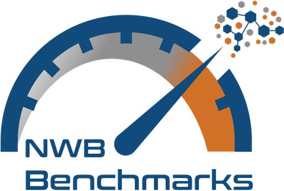

  
  <h1 align="center">NWB Benchmarks Dashboard</h1>
  

    
    
    
  

  

    
    
  

In-browser figures from the [NWB Benchmarks](https://github.com/NeurodataWithoutBorders/nwb-benchmarks) results: the paper's figures, for any machine, software environment or time range.

---

Built & maintained by the [Center for Open Neuroscience](https://centerforopenneuroscience.org).

Funded by the [National Institutes of Health (NIH)](https://www.nih.gov/brain/research/data-knowledge-resources) grant [R24 MH136632](https://reporter.nih.gov/search/kDbcoCvju0ymZz0fI3zvhA/project-details/10888659) as a part of the [Brain Behavior Quantification and Synchronization (BBQS)](https://brain-bbqs.org/) consortium.
